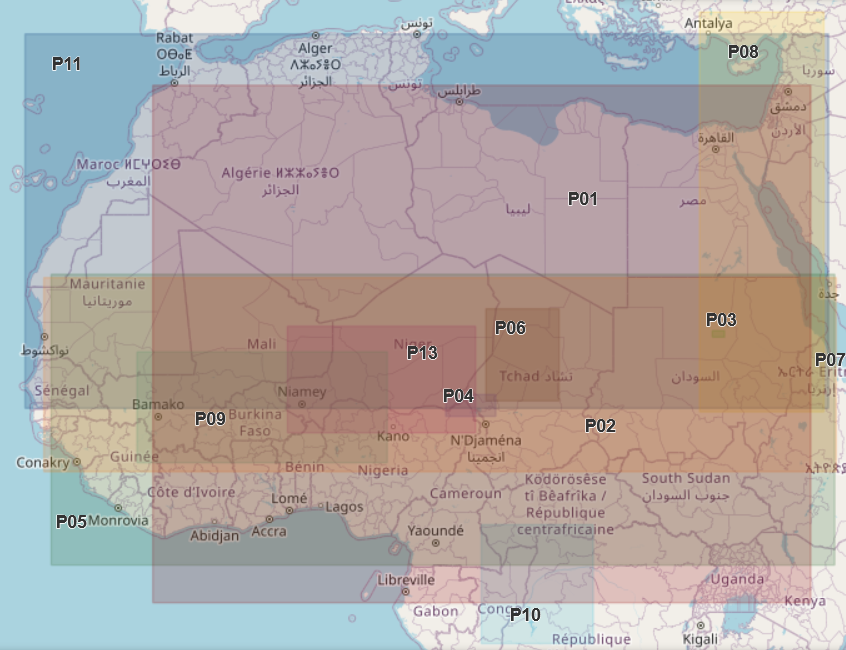
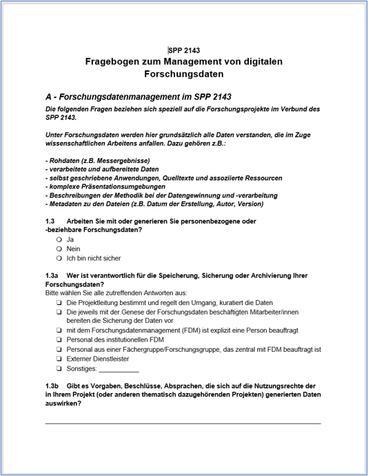
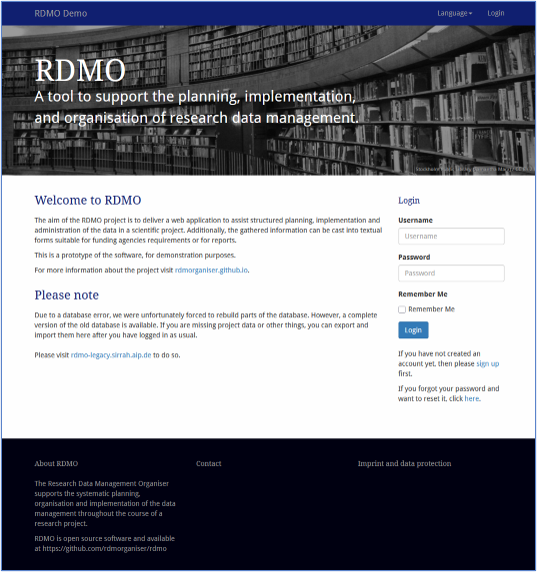
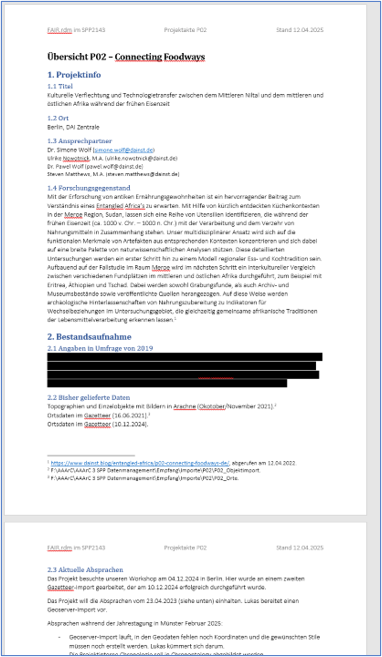
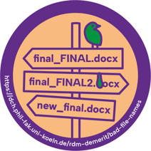
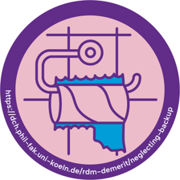
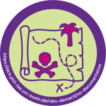
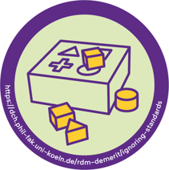
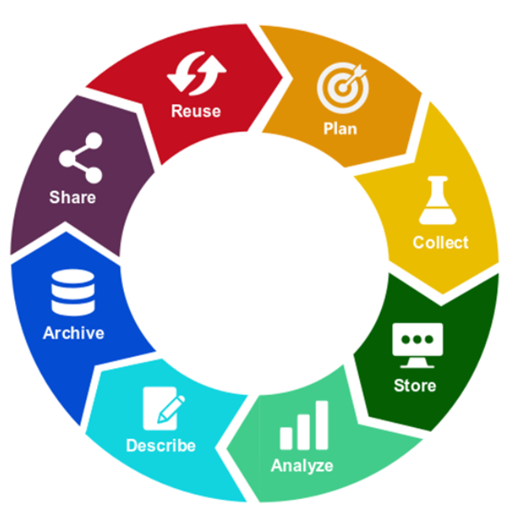

## Overview

In this session, we will cover:

- **Common opinions about DMPs** — why they are often seen as bureaucratic and unhelpful
- **Exchange your own experiences** — about writing or working with DMPs in your research projects
- **Explore additional software** — You could use to create a DMP
- **Identify core elements of DMPs** — to integrate them efficiently into your research workflow

::: {.callout-note}
**Goal:** Learn why DMPs are relvevant and how they can support your work.
:::

---

## 1. Initial Questions {.smaller}

About your experience with Data Management Plans (DMPs):

* Who has written a DMP before?
* Who would be able to show me an up-to-date DMP for their current project?
* Who has no experience with DMPs at all?

---

## 2. Definition {.smaller}

"A Data Management Plan (DMP) provides a structured framework for handling research data in a scientific project. It describes how the data used will be managed both during the project and after its completion. Many third-party funding agencies (DFG, FWF, SNF, Horizon Europe, Volkswagen Foundation) require information on research data management as part of a grant application [...]. In particular, a DMP allows you to document the current status and specific details throughout the entire research data lifecycle. This makes it helpful for administrative purposes and for maintaining an overview."
*[forschungsdaten.info](https://forschungsdaten.info/fdm-allgemein/informieren-und-planen/datenmanagementplan), translated by L. Lammers with DeepL*

"As a planning tool, the data management plan forms the foundation of professional research data management. It provides a systematic overview of the research project in question and outlines how the generated research data will be handled during each phase of its lifecycle, from collection to dissemination. [...]"
*[fdm.uni-koeln.de](https://fdm.uni-koeln.de/wissensbasis/datenmanagementplaene-1), translated by L. Lammers with DeepL*

"A data management plan or DMP is a formal document that outlines how data are to be handled both during a research project, and after the project is completed. The goal of a data management plan is to consider the many aspects of data management, metadata generation, data preservation, and analysis before the project begins; this may lead to data being well-managed in the present, and prepared for preservation in the future."
*[Wikipedia](https://en.wikipedia.org/wiki/Data_management_plan)*

---

## 3. My experiences with DMPS

:::: {.columns}

::: {.column width="55%"}
*Part I*

- SPP 2143 "Entangled Africa: Inner African relations between the rainforest and the Mediterranean, around 6000–500 years ago"

- 13 projects from 2018 to 2026

- Interdisciplinary approach: methods from archaeology, natural sciences, linguistics and many other fields come together

- The projects overlap spatially and temporally

:::

::: {.column width="45%"}

:::

::::

::: {.notes}
Speaker Notes:
:::

---

## 3.1 The first Survey pt. I

:::: {.columns}

::: {.column width="55%"}

- At the start of Entangled Africa a survey was conducted to get an overview about RDM needs

- Are there already data management plans?

- Finding: Very heterogeneous level of knowledge in research data management.

:::

::: {.column width="45%"}
{width=70%}
:::

::::

---

## 3.2 The first Survey pt. II

**Checked: My project does not have a formalized data management plan. (4/10)**

**Following the free text answers:**

- “I'm not sure what a data management plan is.?”

- “best practice”

---

## 3.3 The first Survey pt. III

**Checked: My project has a data management plan for the duration of the project. (3/10)**

**Following the free text answers:**

- “Data management is planned via [names of three repositories].”

- “In accordance with the data management guidelines of the [institution name]”

- “USB stick. First copy on another USB stick stored separately. Second and third copies on separate [network drives] at the [data center]. Fourth to sixth copies on external hard drives at the institute. Seventh to tenth copies on external hard drives at my home. -- Daily backups to at least three of the above storage locations. Regular backup to TSM ([data center]).”

---

## 3.4 The first phase of Entangled Africa

:::: {.columns}

::: {.column width="55%"}

- Survey results became irrelevant:

- Many projects changed original plans

- Workshops and active support in RDM by FAIR.rdm

- Primarily phase of acquiring data: Management of data was done “on the fly”

:::

::: {.column width="45%"}
{width=70%}

{width=70%}
:::

::::

---

## 3.5 The second phase of Entangled Africa

:::: {.columns}

::: {.column width="55%"}

- 2021 - 2026

- None of the original DMP plans were implemented

- Keeping track became difficult (13 projects, 16 repositories in use)

- RDMO was considered

:::

::: {.column width="45%"}
{width=70%}
:::

::::

---

## 4. The perfect DMP: RDMO

- RDMO is a web-based tool for creating and managing data management plans
- it was funded by the DFG
- it is open source and can be self-hosted
- basically a repository (or infrastructure) for DMPs
- the University of Cologne has no RDMO instance

---

## 4.1 Text+ and GRO

- Text+ is the NFDI consortia for linguistics
- as a researcher in this field, you're allowed to use the Text+ instance of RDMO
- it's hosted by university of Göttingen:
- [https://plan.goettingen-research-online.de/](https://plan.goettingen-research-online.de/)

---

## 5. Practical exercise with GRO

[https://plan.goettingen-research-online.de/](https://plan.goettingen-research-online.de/)

- Log in to GRO! (Federated Login via your university account)
- Create a new project for your current research project
- Pick either Text+ questionaire or the DFG linguistics template for spoken corpus or text corpus
- Fill in the DMP template with your own information (not too detailed, just a rough overview about the contents and questions)
- YOu have 20 minutes

---

## 5.1 Practical exercise with GRO: Results

- What was your experience with the DMP template?
- What advantages do you see?
- Are there any disadvantages?
- Would you consider to using it for your own research project?

---

## 6. My experiences with DMPs

:::: {.columns}

::: {.column width="55%"}

Part II

- To use RDMO in Entangled Africa, we would have had to create a new instance of RDMO for the SPP 2143
- Far too much work!
- instead we used living documents, simple word files
- Structure: Project Metadata, Project data history, Record of published and to pubish data, current agreements
- Fast, easy, see the most important things quickly

:::

::: {.column width="45%"}
{width=70%}
:::

::::

---

## 6.1 Lessons learned

:::: {.columns}

::: {.column width="60%"}

- This worked well and the project was a success in general
- But a few problems occured:
- A lot of data is unpublished
- Organization of raw data in some projects is not documented and it’s nearly impossible for people from outside to work or even understand the data
- The researches know this issue (method to protect the data?)
- One project lost huge amounts of data (hard drives got lost). 
- A DMP can help to avoid these situations

:::

::: {.column width="40%"}

::: {style="display: grid; grid-template-columns: 1fr 1fr; gap: 15px; justify-items: center; align-items: center;"}

::: {}

:::

::: {}

:::

::: {}

:::

::: {}

:::

:::

:::

::::

---

## 7. Key Aspects of DMPs

- RDMO is often praised as the perfect tool for creating DMPs
- **But a good DMP does not depend on the format, the content is more important!**
- You can find many templates and guiding questions online
- Uni Köln: [fdm.uni-koeln.de](https://fdm.uni-koeln.de/en/rdm-knowledge/data-management-plans)
- forschungsdaten.info: [forschungsdaten.info](https://forschungsdaten.info/fdm-allgemein/informieren-und-planen/datenmanagementplan)
- key aspects can be derived from common rdm principles

---

## 8. FAIR Data Principles

- Do you remember the FAIR principles?

The acronym FAIR stands for

- **F**indable
- **A**ccessible
- **I**nteroperable
- **R**eusable

- originally they apply to metadata as technical guidelines but today they are also used as a general framework for good research data management
- original article: [Wilkinson et al. (2016)](https://www.nature.com/articles/sdata201618)

---

## 9. Research Data Lifecycle

:::: {.columns}

::: {.column width="60%"}

- Do you remember what the research data lifecycle is?
- The decisions on how to prepare and conduct every step are a complete DMP

:::

::: {.column width="40%"}

:::

::::

---

## 10. Choice for a Repository

The choice for a repository can shape your DMP very much, e.g.:

- Which file formats are accepted?
- How is personal data handled?
- How is the data licensed?
- Is long term archiving possible?
- etc.

---

## 11. Conclusion

- you can spend a lot of time filling out endless questionaires
- a DMP should support your work, not be a bureaucratic burden
- a DMP should be a living document, not a static one
- start with basic descions using common data management principles:
- most important: wich kind of data will be generated and where will it be stored?

---

## References {.smaller}

::: {#refs}
- Slide "3. My experiences with DMPS": Simon Kellers, [DAI Geoserver](https://geoserver.dainst.org/catalogue/#/map/8374)
- Slide "6.1 Lessons learned", DCH Demerit Badges: RDM Demerit Badges, CC-BY 4.0 Elisabeth Mollenhauer (badges) and Felix Rau (text), [DCH Uni Köln](https://dch.phil-fak.uni-koeln.de/rdm-demerit)
- Slide "9. Research Data Lifecycle": SZF TU Berlin, CC BY 4.0, [TU Berlin SZF](https://www.tu.berlin/en/ub/szf/tips-tools/what-is-research-data-management)

:::
