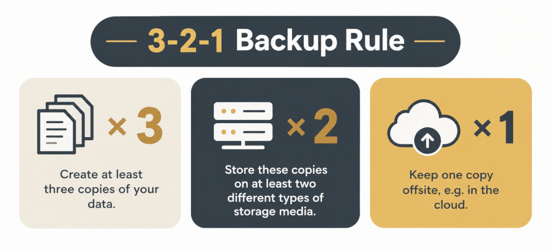

## Overview {.smaller}

::: {.columns}

::: {.column width="58%"}
### Session Plan

- **3-2-1 Backup-Rule** and options in CRC 1252
- **Storage Media:** local vs cloud solutions
- **Preparing a backup** filenaming, documentation, and versioning
- **Automating backups** useful additional tools
- **Testing a restore** and verifying integrity of backups
- **Backup plan** and discussion of individual backup strategies

:::

::: {.column width="42%"}

::: {.callout-note}

### Goal

Today you'll learn how to create a practical backup plan for your research data, including the infrastructure, further guidelines and tools available at the University of Cologne.

:::

:::

:::

::: {.notes}
Speaker Notes:
- bla
- bla
:::

---

## 1. Initial Questions {.smaller}

About your experience with Backups:

* Are you doing backups?
* Where do you store your backups?
* How regularly do you do backups?
* Did you ever had to restore data from a backup?
* Have you encountered any problems?

::: {.notes}
Speaker Notes:
- Gather needs and experience of the audience:
- How do you handle backups?
- Are there urgent problems?
- Why are you here?
- Lukas "Horror Story"
:::

---

## 2. The 3-2-1 Backup Rule {.smaller}

**The basic and easy to remember backup concept is the 3-2-1 rule:**

* Keep 3 copies of your data
* Store 2 copies on different media
* Keep 1 copy offsite

**How can you apply this rule in your research environment?**

Do you know some soulutions?

::: {.notes}
Speaker Notes:
- 
:::

---

## 3. Data Protection {.smaller}

**If you're working with sensitive data, the backups have to be protected.**

* Password-protect your backups
* Encryption
* Pseudonymization / Anonymization

For more information you're invited to the RD&M Workshop on data protection on 06.01.2027 here at 14:00!

---

## 4.1 Storage Media {.smaller}

**Local storage:**
- multiple PCs
- external hard drives 
- USB sticks
- CD / DVD

**Cloud storage:**
- Proprietary solutions (e.g., [OneDrive](https://onedrive.live.com), [Dropbox](https://www.dropbox.com), [Google Drive](https://drive.google.com))
- University of Cologne solutions (e.g., [Sciebo](https://uni-koeln.sciebo.de), [SOFS](https://itcc.uni-koeln.de/services/daten-speichern-teilen/online-speicher-sofs), [DataStorage.nrw bzw. Coscine](https://coscine.rwth-aachen.de))
- Long Term Archiving (done by Project S via Sciebo at the ITCC of the University of Cologne)

---

## 4.2 Guess the Lifespan

**Guess the lifespan of the following storage media:**

External hard drives

**3-5 years**

USB sticks

**2-3 years**

CD/DVD

**10-20 years**

Cloud

**as long as the service is maintained**
and the account not deleted or hacked

Long Term Archiving

**minimum 10 years**

---